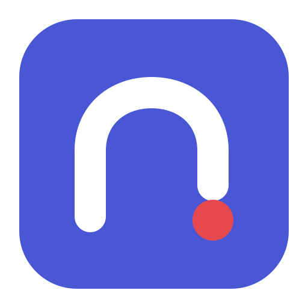
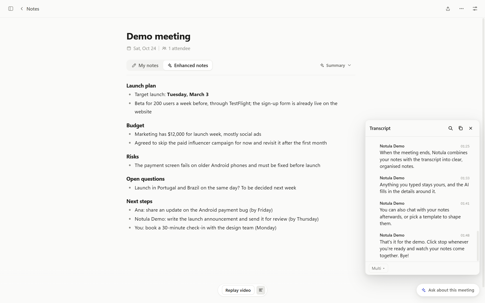
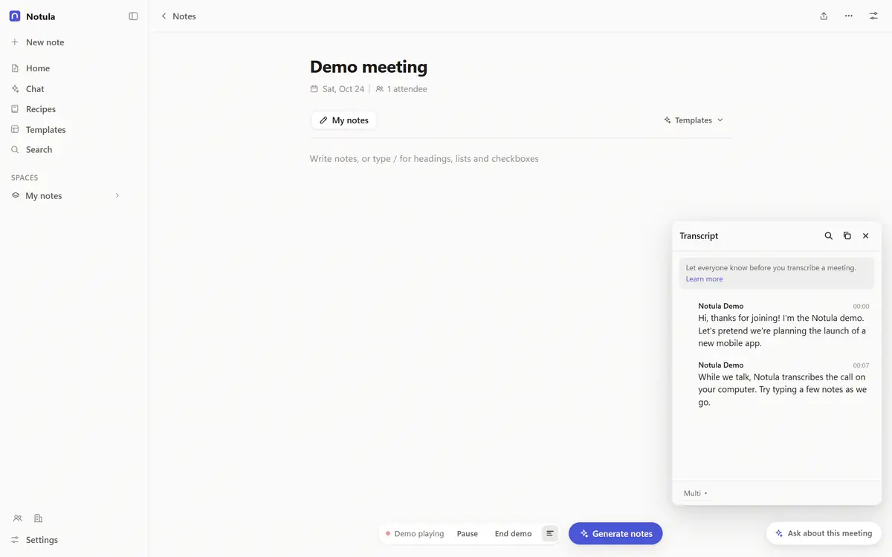
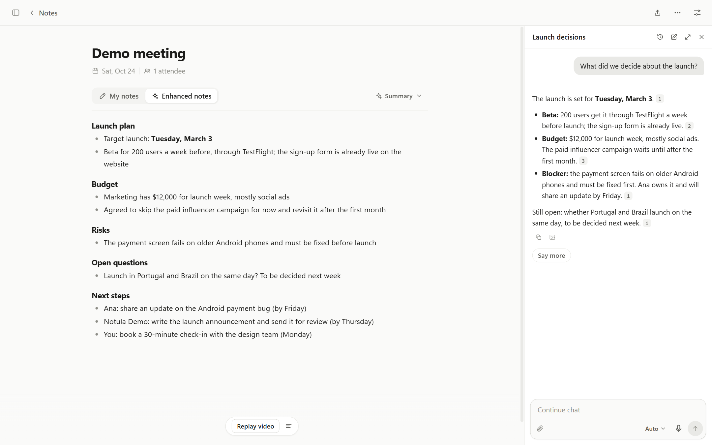
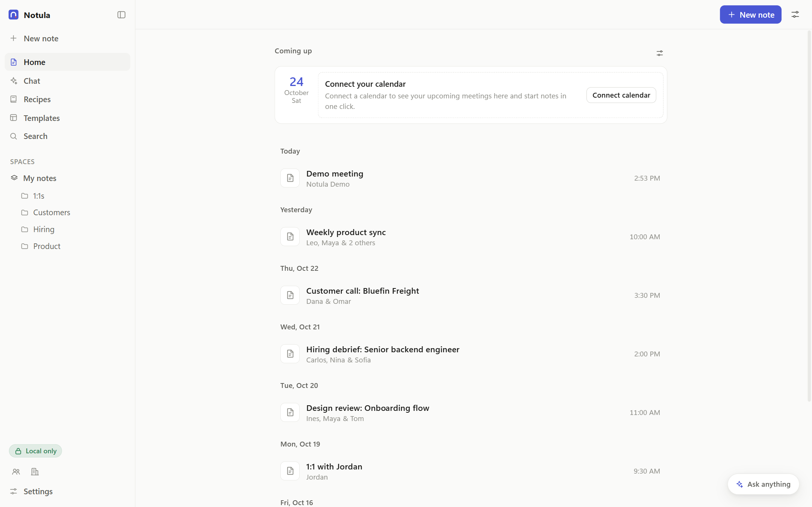
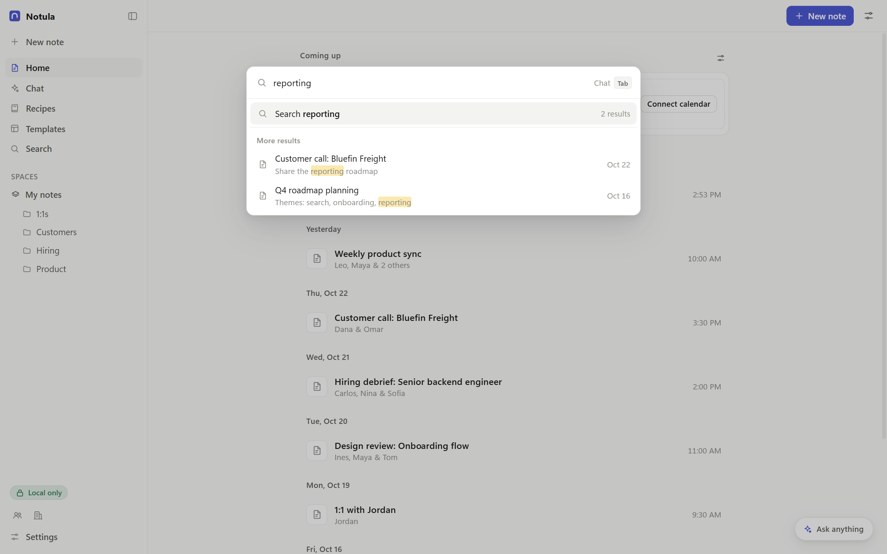
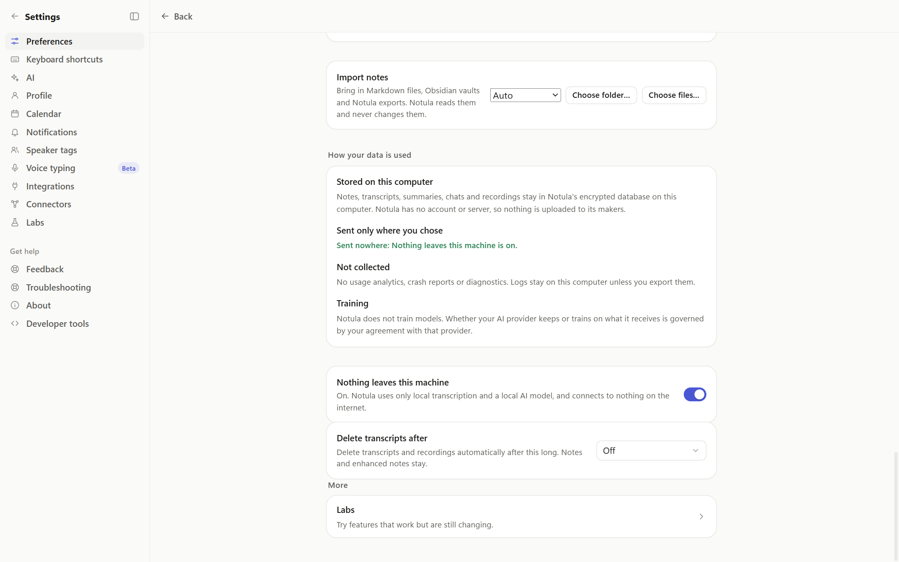
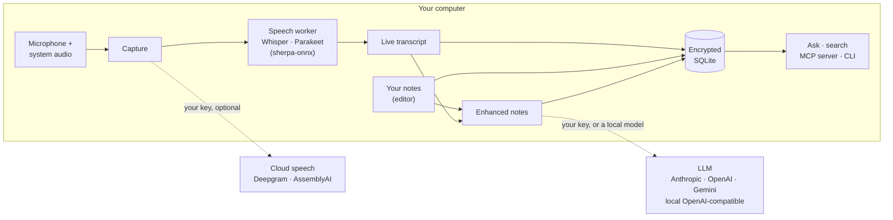

<div align="center">



# Notula

**Open-source, local-first AI meeting notes.**

A live transcript, the notes you type, and AI-enhanced summaries.<br>
Stored on your computer, sent only to the AI you choose.

[](https://github.com/augusto-dmh/notula-releases/releases/latest)
[](LICENSE)
[](#install)
[](CONTRIBUTING.md#sign-your-commits-dco)

[**Download for Windows**](https://github.com/augusto-dmh/notula-releases/releases/latest) ·
[Features](#features) ·
[Benchmarks](docs/benchmarks.md) ·
[Build from source](#build-from-source) ·
[Contributing](CONTRIBUTING.md)

<br>

<picture>
  <source media="(prefers-color-scheme: dark)" srcset="docs/images/hero-dark.png">
  
</picture>

</div>

## Why Notula

- **Your notes stay yours.** No account, no Notula server and no telemetry. Notes, transcripts and recordings live in an encrypted database on your computer.
- **Your AI, your choice.** Transcribe on the device with open speech models, or use a cloud service with your own key. Write notes with Anthropic, OpenAI, Gemini or a model running on your own machine.
- **Notes you can trust.** The notes are built from what was said and what you typed, and the transcript is always there to check them against. We measure the quality and publish the method: see the [benchmarks](docs/benchmarks.md).
- **No bot in the call.** Notula listens on your computer to your microphone and the meeting's sound. Nobody has to admit a bot, and it works with any meeting app, a video or a lecture.

## Features

### During the meeting



- **Live transcript** of your microphone and the meeting's system audio, with speaker labels.
- **Your notes beside it,** in a rich editor with headings, lists, checkboxes and attachments.
- **Hands-free:** Notula can detect a meeting starting, offer to take notes, and stop by itself after a long silence.

### After the meeting

- **Enhanced notes:** Notula merges your notes and the transcript into structured notes: decisions, action items with owners, open questions and next steps.
- **Templates** for one-on-ones, stand-ups, sales calls, user and candidate interviews, brainstorms, lessons and more, or write your own.
- **Follow-ups:** a follow-up email draft, a better title, and regeneration with different instructions.

### Ask your notes



Chat with one note or with your whole library: "What did we decide about the budget?" or "What did Ana promise last week?" Answers cite the notes they come from.

### Your library

<table>
  <tr>
    <td width="50%"></td>
    <td width="50%"></td>
  </tr>
</table>

Folders, full-text search, people, action items, and copy or export to Markdown. You can import folders of Markdown notes, including vaults with wikilinks and front-matter. Notula reads the files and never changes them.

### More

| | |
|---|---|
| **Dictation** | Voice typing into any app, with a small floating bar. |
| **Calendar** | Upcoming meetings from ICS feeds or your own Google or Microsoft OAuth client, with reminders before they start. |
| **Integrations** | Send notes to Slack, Notion, HubSpot, Attio, Affinity or Zapier. Every call goes straight from your computer to the service, with your credentials. |
| **MCP** | Connect your own MCP servers, and let your AI tools read your notes through Notula's local MCP server. |
| **Agent skill** | A local `notula` command and a skill for Claude Code, Codex and Cursor, so a coding agent can look up what was said in a meeting. |
| **Sources (Labs)** | Take notes on a video or a course lesson in your browser. Each transcript line is stamped with its time in the video, and lessons are filed into course folders. Uses the optional [browser extension](extension/README.md). |
| **Automations (Labs)** | Rules that run when a meeting ends, such as filing the note in a folder or calling a webhook. |

## Privacy



- **Data stays on the machine.** Notes, transcripts, recordings and settings live in an encrypted SQLite database (SQLCipher) in your user-data folder.
- **Local-only mode.** Settings ▸ Preferences ▸ "Nothing leaves this machine" blocks every network request except to loopback addresses. That covers cloud AI and transcription, calendar sync, integrations and update checks.
- **Keys in the OS keychain.** API keys and tokens are protected with Electron `safeStorage` (DPAPI on Windows, Keychain on macOS). They are never written to files, logs or exports.
- **Your providers only.** Transcription and AI requests go only to the providers you set up, or to on-device and local models.
- **What goes to GitHub.** Notula checks for updates and downloads them from GitHub, where its releases are hosted (`augusto-dmh/notula-releases`). Update checks send the app version and platform. Speech models and the optional yt-dlp tool are downloaded from GitHub only when you ask for them.
- **Recording consent.** You're responsible for telling people they're being recorded and for following the recording laws that apply to you and to them. Get their consent before you record them.

## Benchmarks

We compared Notula with another commercial AI meeting-notes app ("Other app A") on the same input.
- **Transcription:** four lectures in Brazilian Portuguese.
- **Notes:** 14 public talks, judged blind.

<p align="center">
  
</p>

| | Notula | Other app A |
|---|---|---|
| Word error rate, normal level (lower is better) | **15.6 %** | 35.7 % |
| Key terms kept in the transcript | **54 of 69** | 33 of 69 |
| Notes preferred by a blind judge (14 talks) | **10** | 2 (2 ties) |
| Key points covered by the notes | **84 %** | 71 % |
| Words per set of notes | 782 | **401** |

The method, every number and the limits are in [docs/benchmarks.md](docs/benchmarks.md). Other app A writes shorter notes. It also lost fewer words on very quiet audio than Notula 0.0.4, which Notula 0.0.5 fixed.

## How it works



Notula is an Electron app written in TypeScript and React.
- **Main process:** owns capture, storage and every network call. Heavy work runs in utility processes: the database, speech recognition, speaker separation and file conversion.
- **Interface:** talks to the main process only through a typed IPC contract in `src/shared`.
- **Storage:** SQLite encrypted with SQLCipher, through `better-sqlite3-multiple-ciphers`.
- **On-device speech:** `sherpa-onnx-node`. The models are downloaded on demand and pinned by SHA-256 (see [`MODELS.md`](MODELS.md)).

## Install

Download the latest installer from the [releases page](https://github.com/augusto-dmh/notula-releases/releases/latest) and run it. Installed copies update themselves from the same releases.

Builds aren't code-signed yet, so Windows SmartScreen warns on first run. Choose **More info ▸ Run anyway**.

| Platform | Status |
|---|---|
| Windows 10 and 11 (x64) | Supported |
| macOS | Experimental: builds from source, not tested regularly |
| Linux | Not supported yet |

Notula is young (0.0.x) and changes quickly. Expect rough edges, and please [report them](https://github.com/augusto-dmh/notula/issues).

## Build from source

You need Node.js 24 or later and npm.

```sh
git clone https://github.com/augusto-dmh/notula.git
cd notula
npm ci                # install dependencies
npm run dev           # run the app with hot reload
npm run typecheck     # type check
npm run build         # production build into out/
npm run dist          # Windows installer into dist/
```

`NOTULA_USER_DATA_DIR` points a dev run at a scratch profile, so you don't touch your real notes.

<details>
<summary><b>Optional build-time variables</b></summary>

- `NOTULA_UPDATE_FEED_URL`: the update feed baked into the installer. Without it, builds use the project's releases feed. Set it to an empty string to build without updates.
- `NOTULA_FEEDBACK_EMAIL` and `NOTULA_ISSUES_URL`: where Send feedback points.

</details>

<details>
<summary><b>App icon</b></summary>

The app icon lives in `resources/icon/icon.svg`. After changing it, regenerate the PNG and ICO files:

```sh
npx electron scripts/icon/render.cjs resources/icon/icon.svg resources/icon <scratch folder for Electron's profile>
```

</details>

<details>
<summary><b>Screenshots</b></summary>

The images in `docs/images/` are made from the built app on a throwaway profile with demo data. See [`scripts/dev/screenshots/`](scripts/dev/screenshots/) to make them again.

</details>

### Project layout

| Path | What |
|---|---|
| `src/main` | Electron main process and utility-process workers (storage, speech, speaker separation and others) |
| `src/preload` | The isolated preload (contextBridge only) |
| `src/renderer` | The React interface |
| `src/shared` | The contract between the interface and the main process: every IPC channel and its types |
| `resources/` | Icons, the demo meeting and helper files shipped next to the app |
| `extension/` | The optional browser extension (its own build: `npm --prefix extension run build`) |
| `scripts/dev/` | Small development checks, fixtures and the screenshot script |
| `docs/` | Benchmarks and images |
| `AGENTS.md` | Notes for coding agents working in this repository |
| `style/COPY.md` | The guide for interface text |

Publishing installers is maintainer-only and not part of this repository. Contributors only need `npm run dist` to build an installer locally.

## FAQ

<details>
<summary><b>Does Notula work offline?</b></summary>

Yes. Use on-device transcription, a local OpenAI-compatible model server (for example Ollama), and turn on "Nothing leaves this machine". Without a language model set up, you still get the transcript and your own notes.

</details>

<details>
<summary><b>Which languages does it transcribe?</b></summary>

On the device, Whisper large-v3-turbo covers about 100 languages, and Parakeet TDT 0.6B v3 covers 25 European languages. The cloud services cover their own lists. Notes are written in English or in the meeting's own language, as you choose.

</details>

<details>
<summary><b>What does it cost?</b></summary>

Notula is free. If you use a cloud AI or speech service, you pay that provider directly for your own usage.

</details>

<details>
<summary><b>Do I need the browser extension?</b></summary>

No. It's only for Sources (Labs), to tell the app which video or lesson is playing. It talks only to the app on the same computer.

</details>

## Contributing

Contributions are welcome: bug reports, fixes and ideas. Please read [`CONTRIBUTING.md`](CONTRIBUTING.md) first. Every commit needs a DCO sign-off (`git commit -s`), and AI-assisted contributions must say so.

- **Security issues:** report them privately, as described in [`SECURITY.md`](SECURITY.md).
- **Code of conduct:** everyone taking part follows the [Code of Conduct](CODE_OF_CONDUCT.md).

## Acknowledgements

Notula stands on excellent open-source work, including:
- [Electron](https://www.electronjs.org/) and [React](https://react.dev/);
- [Tiptap](https://tiptap.dev/) and [Yjs](https://yjs.dev/);
- [SQLite](https://sqlite.org/) with [SQLCipher](https://www.zetetic.net/sqlcipher/);
- [sherpa-onnx](https://github.com/k2-fsa/sherpa-onnx) and [ONNX Runtime](https://onnxruntime.ai/);
- OpenAI's [Whisper](https://github.com/openai/whisper), NVIDIA's [Parakeet](https://huggingface.co/nvidia/parakeet-tdt-0.6b-v3), [pyannote](https://github.com/pyannote/pyannote-audio) and [WeSpeaker](https://github.com/wenet-e2e/wespeaker);
- the [Model Context Protocol](https://modelcontextprotocol.io/) SDK.

The full list is in [`THIRD_PARTY_NOTICES.md`](THIRD_PARTY_NOTICES.md).

## Licence

Notula is licensed under the [Apache License 2.0](LICENSE). See:
- [`NOTICE`](NOTICE);
- [`THIRD_PARTY_NOTICES.md`](THIRD_PARTY_NOTICES.md) for bundled dependencies;
- [`MODELS.md`](MODELS.md) for the speech models and the optional tool Notula downloads.

The installer ships these files too, and Settings ▸ About ▸ Open-source licenses shows them in the app.

Notula's code, interface text and artwork were written for this project, with help from AI coding assistants.
