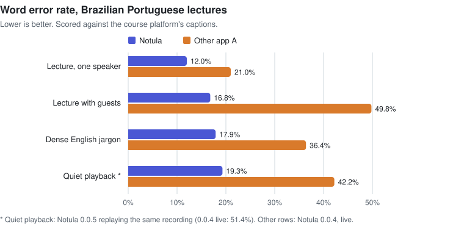

# Benchmarks

How well does Notula transcribe, and how good are its notes? This page reports two benchmarks we ran in October 2026. Each one compares Notula with another commercial AI meeting-notes app, called **Other app A** here, on the same input.

Treat them as one data point, not a verdict. The samples are small, there is no human-made reference transcript, and the judges are language models. The limits are listed under each benchmark.

## Results at a glance

| | Notula | Other app A |
|---|---|---|
| Word error rate, Portuguese lectures at normal level (mean of 3) | **15.6 %** | 35.7 % |
| Key terms kept in the transcript (names, tools, numbers) | **54 of 69** | 33 of 69 |
| Word error rate, quiet playback (Notula 0.0.5, replay) | **19.3 %** | 42.2 % |
| Notes preferred by a blind judge (14 talks, both orders agree) | **10** | 2 (2 ties) |
| Key points covered by the notes (14 talks) | **84 %** | 71 % |
| Severe errors per set of notes (14 talks) | **0.1** | 0.4 |
| Words per set of notes (14 talks) | 782 | **401** |

  

## 1. Transcription of Brazilian Portuguese lectures

### Setup
- **Audio:** four 10-minute windows of recorded technical course lectures in Brazilian Portuguese:
  - one speaker at normal level;
  - a conversation with two guests;
  - a lecture dense with English technical terms;
  - the same kind of lecture at a quiet level (player at 25 % volume, about 12 dB lower).

  The course is members-only, so the audio and transcripts aren't published.
- **Both apps at once:** both apps ran on the same Windows 11 laptop and heard the same playback through system audio.
  - Their microphone was a silent virtual input, so neither had a microphone channel.
  - The speakers were muted after the point where the apps capture, so the room stayed silent.
  - A script drove both apps through their own interfaces: new note, start, stop, copy the transcript.
- **Settings:** each app used the setting for automatic language detection.
  - Notula 0.0.3 and 0.0.4 transcribed on the device with Whisper large-v3-turbo.
  - Other app A ran with its default settings.

### Scoring
- **Three references:** no human transcript exists, so each app's transcript was scored against three independent machine references:
  - the course platform's own captions;
  - NVIDIA Parakeet TDT 0.6B v3, run over our own recording of the same audio;
  - Whisper large-v3, run over the same recording. Whisper is the same model family as Notula's, so this reference favours Notula. It is reported for completeness only.

  A result that holds against the captions and against Parakeet doesn't depend on one model's quirks.
- **Normalisation:** both sides were normalised the same way: lowercase, no punctuation, numbers spelled out, hesitations removed. Only the stretch of the reference that both apps cover was scored, so a late start isn't counted as missing words.
- **Metrics:**
  - word error rate (WER) and character error rate with jiwer;
  - recall of 20–25 key terms per window: names, tools, acronyms and numbers;
  - stray words in the wrong script, which is how speech models show language-switch errors.

### Results (Notula 0.0.4, run of 2026-10-17)

| Window | WER vs captions, Notula / Other app A | WER vs Parakeet, Notula / Other app A | Key terms kept, Notula / Other app A |
|---|---|---|---|
| One speaker | **12.0 %** / 21.0 % | **8.0 %** / 20.3 % | **20** / 14 of 22 |
| With two guests | **16.8 %** / 49.8 % | **14.4 %** / 49.1 % | **18** / 8 of 25 |
| Dense English terms | **17.9 %** / 36.4 % | **15.3 %** / 36.2 % | **16** / 11 of 22 |
| Quiet playback | 51.4 % / **42.2 %** | 48.3 % / **41.1 %** | **13** / 8 of 20 |

- **At normal level, Notula makes less than half the word errors** against every reference, and it keeps more of the names and terms. An earlier run with Notula 0.0.3 gave the same picture: a mean of 15.5 % against 36.0 % at normal level.
- **At quiet level, Notula 0.0.4 lost whole stretches of speech**, including gaps of up to 39 words, and fell behind Other app A. Notula 0.0.5 changed how on-device transcription detects quiet speech. Replaying the same recording through it gives:
  - a WER of **19.3 %** (from 51.4 %);
  - 100 deleted words instead of 710;
  - 15 of 20 key terms;
  - no wrong-script characters.

  This is an offline replay, not a new live run of both apps.
- Notula 0.0.4 still produced a few stray words in a non-Latin script in one window. Notula 0.0.5 also removes those once it knows the session's language.

### Notes from the same sessions
Notula wrote its notes with `gemini-3.8-flash`, and Other app A with its own models.
- **Judging:** two blind judges (`claude-opus-5-5`, the second with the two sets in swapped order) graded both sets of notes against key points taken from the reference transcripts.
- **Preference:** all 8 verdicts per run preferred Notula's notes.
- **Coverage:** Notula's notes covered 69 % of the key points, Other app A's 44 %.
- **Errors:** the judges found 1.4 factual errors per set of Notula's notes and 6.9 per set of Other app A's (Notula 0.0.4).

Much of that gap comes from transcription: notes can't be better than the transcript they're written from. The next benchmark controls for that.

### Limits
- Four 10-minute windows is a small sample. Differences of a few points within one window are noise.
- No human ground truth. Absolute WERs include each reference's own errors (the references differ from each other by 7–18 %), so compare the apps against the same reference rather than reading the numbers as absolute.
- One language, Brazilian Portuguese, and one kind of content: technical lectures.

## 2. Notes quality on public talks

### Setup
- **Cases:** 14 public software-engineering talks on YouTube, 11 in English and 3 in Portuguese, each between 1,300 and 11,800 words long. For each talk we had a set of notes that Other app A wrote when the talk was played to it.
- **Notula's notes:** the same talk's captions went through Notula 0.0.11's own note-writing request, with the default template and no typed notes, to `gemini-3.8-flash`. The output language was set to Brazilian Portuguese to match Other app A's notes, so the judge couldn't tell the apps apart by language.
- **This favours Notula.** Notula wrote from clean captions, while Other app A wrote from its own live transcript. Part of the gap below is transcript quality.

### Judging
These are the usual controls against judge bias:
- **Key points first:** `claude-opus-5-5` listed 8–17 key points per talk from the transcript alone, before seeing any notes.
- **Blind and normalised:** both sets of notes went through one normaliser (same headings, bullets and nesting; bold and footers removed).
- **Both orders:** each pair was judged twice, with A and B swapped. A win counts only when both orders agree.
- **Separate scores:** coverage per key point, then every factual error (flagged severe or not), then nine 1–5 scores: fidelity, conclusions, caveats, depth, structure, review value, cold reading, attribution and concision.
- **Fact check:** a separate call split each set of notes into single claims and checked each one against the transcript.

### Results

| | Notula 0.0.11 | Other app A |
|---|---|---|
| Talks won (both orders agree) | **10** | 2 (2 ties) |
| Verdicts won (28, both orders counted) | **22** | 5 (1 tie) |
| Key points covered | **84 %** | 71 % |
| Claims supported by the transcript | **98 %** | 97 % |
| Severe errors per set of notes | **0.1** | 0.4 |
| All judge-flagged errors per set of notes | 4.0 | **2.8** |
| Depth (1–5) | **4.2** | 2.9 |
| Reads well on its own, later (1–5) | **4.4** | 3.5 |
| Concision (1–5) | 3.6 | **4.6** |
| Words per set of notes | 782 | **401** |

- **Notula's notes cover more and go deeper,** and the judge preferred them on 10 of 14 talks.
- **Other app A's notes are about half as long and more concise.**
- **The two apps make different kinds of mistakes.**
  - Notula's are mostly small embellishments: a stronger word than the speaker used, a dropped hedge, a textbook label the speaker didn't say.
  - Other app A had fewer flagged errors overall but more severe ones, such as numbers the speaker never gave.

  Both findings feed the work on Notula's prompts.
- The judge was consistent: it gave the same verdict in both orders on 12 of 14 talks.

### Limits
- One judge model family. The key points also come from it. Swapping the order controls position bias, not the model's taste.
- Lectures only: no meetings with decisions, owners and typed notes.
- One sample per talk. The note-writing model isn't deterministic.
- Notula's note-writing request has changed since 0.0.11. Notes on videos and lessons now also use the source's title and details. The results above are for 0.0.11.

## Why "Other app A"
Notula doesn't name other products in its code or docs, and this page follows the same rule. The numbers describe the other app as we measured it in October 2026. Its models and prompts can change at any time without a version change.

## Reproducing
The audio, captions and talk transcripts are copyrighted, and the other app's output isn't ours to publish. So the inputs and the harness aren't in this repository. You can check the Notula side on your own recordings:
1. Turn on on-device transcription in Settings ▸ AI.
2. Play the same audio to Notula.
3. Score the transcript with any WER tool against a reference you trust.

We'd welcome an open, reproducible benchmark on freely licensed audio. Please open an issue if you'd like to help build one.
